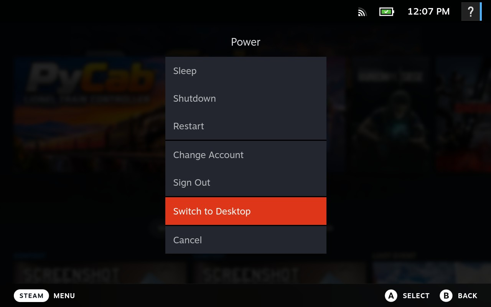

# PyCab Flatpak

[](https://github.com/cdswindell/PyCab-Flatpak/releases/latest)
[](https://github.com/cdswindell/PyCab-Flatpak/actions/workflows/release.yml)
[](https://github.com/cdswindell/PyLegacy/tags)

**New Steam Deck?** Follow [the complete installation guide](INSTALL_STEAM_DECK.md), including optional SSH setup, Flatpak installation, Steam shortcut configuration, and controller testing.

Steam Deck Flatpak packaging for PyCab, the controller for [PyTrain (PyLegacy)](https://github.com/cdswindell/PyLegacy). The Flatpak installs the `pytrain-ogr-deck` Python distribution rather than building PyLegacy source. See the [latest published PyCab release](https://github.com/cdswindell/PyCab-Flatpak/releases/latest) for the current release.

## Requirements

- Steam Deck running SteamOS with internet access and sufficient storage.
- Git, curl, Python 3, Flatpak, and SHA-256 tools (normally available on SteamOS).
- Reachable PyTrain server (client mode) or Lionel Base 3 (server mode).
- Desktop Mode to exit Steam before the installer edits its library.

Installing a published release does **not** build Python, Tcl/Tk, or PyTrain.

## Install on a new Steam Deck (recommended)

**Switch to Desktop Mode:**

1. From **Gaming Mode**, press the physical **STEAM** button on the left side of the Deck.
2. Select **Power**, then **Switch to Desktop**.
   
   

3. Wait for the KDE desktop to appear.
4. Open the Steam desktop app's **Steam** menu and select **Exit**; wait until Steam has fully closed.
5. Open the application launcher in the lower-left corner and launch **Konsole**.
6. In Konsole on the Deck (or over SSH), run:

   ```bash
   cd ~
   git clone https://github.com/cdswindell/PyCab-Flatpak.git
   cd PyCab-Flatpak
   ./install-release.sh
   ```

For more detail, see [the Steam Deck installation guide](INSTALL_STEAM_DECK.md#1-prepare-the-deck).

The script fetches the **latest published GitHub release**, verifies its Flatpak checksum, installs the user Flatpak and host launcher, creates the PyCab non-Steam shortcut, and installs custom Steam artwork. It backs up Steam's shortcuts file and preserves other shortcuts. If Steam is still running, shortcut creation is deferred until you exit Steam and run the command printed by the installer.

Restart Steam or return to Gaming Mode, open **Library > Non-Steam > PyCab**, and select **Play**. Enable Steam Input under **Properties > Controller** if needed. See [INSTALL_STEAM_DECK.md](INSTALL_STEAM_DECK.md) for complete setup, SSH, and client/server options.

**Do not use `/usr/bin/flatpak` as the Steam shortcut target.** The installer configures `~/.local/bin/pycab-steam` to avoid a white Tk window seen with direct Flatpak launches from Steam.

## Client and server modes

**Recommended: client mode with a dedicated PyTrain server.** Leave Steam's **PyCab > Properties > Shortcut > Launch Options** empty (the default). PyCab then connects to a separate PyTrain server. For the most complete Lionel control setup, run that server on a dedicated computer (such as a Raspberry Pi) connected to **both the Lionel Base 3 over Wi-Fi/network and an LCS Ser2 over USB**. This arrangement avoids relying on the Base 3 alone for functions that require the LCS connection and keeps the Steam Deck focused on being a handheld controller.

**Alternative: run PyCab in server mode on the Steam Deck.** In Steam, open **PyCab > Properties > Shortcut** and set **Launch Options** to:

| Launch Options | Mode |
| --- | --- |
| *(empty)* | **Client (recommended):** connect to your separate PyTrain server. |
| `-base` | **Server:** connect to a Base 3 discovered on the network. |
| `-base 192.168.4.100` | **Server:** connect to a Base 3 at that IP address (replace with yours). |

The Deck must be able to reach the Base 3; automatic discovery also requires compatible network settings. A Deck running server mode with only a Base 3 connection may not offer the same coverage as a dedicated server with both Base 3 and LCS Ser2 connections.

For a local graphical Konsole test (not over SSH):

```bash
flatpak run io.github.cdswindell.PyCab              # client mode
flatpak run io.github.cdswindell.PyCab -base        # server; discover Base 3
flatpak run io.github.cdswindell.PyCab -base 192.168.4.100  # server; specific Base 3
```

## Update PyCab when a new release is published

From Desktop Mode, **exit Steam completely** and run on the Deck (or over SSH):

```bash
cd ~/PyCab-Flatpak
git pull --ff-only origin master
./install-release.sh
```

`git pull` updates the installer and artwork; `install-release.sh` downloads and verifies the latest **published** Flatpak, reinstalls it without deleting application data, and refreshes Steam integration. The existing shortcut and controller settings are preserved. Updates are **manual**, not automatic.

## Alternative: standalone ZIP (no Git)

If you prefer not to clone the repository, download `PyCab-Installer.zip` from the [latest GitHub release](https://github.com/cdswindell/PyCab-Flatpak/releases/latest), extract it, and run `bash install-bundle.sh` inside the extracted `PyCab-Installer` directory. It also verifies the checksum and installs Steam integration. For future updates, download a new ZIP and rerun its installer.

## Developer installation and removal

`install.sh` is a **developer/checkout-oriented** alternative, not the recommended first-install procedure. By default it downloads the latest Flatpak without the release checksum verification performed by `install-release.sh` or `install-bundle.sh`. With `--build`, it builds locally using Flatpak Builder.

```bash
# On Steam Deck, from a repository checkout:
bash install.sh --build
```

To uninstall, remove the PyCab shortcut from Steam manually, then run `bash uninstall.sh` from a checkout, or `flatpak uninstall --user io.github.cdswindell.PyCab` if you only have the ZIP. Uninstalling the Flatpak does not remove its application data or Steam artwork automatically.

## Script reference

See [RELEASE_AUTOMATION.md — Script reference](RELEASE_AUTOMATION.md#script-reference) for the purpose, host requirements, and usage of every repository shell script, including the CI build and packaging scripts.

## Creating a release

See [RELEASE_AUTOMATION.md](RELEASE_AUTOMATION.md) for the full workflow.

On the development Mac, after tagging PyLegacy and publishing both PyPI
distributions:

```bash
./publish-release.sh --dry-run
./publish-release.sh
```

The script checks both PyPI distributions, regenerates the Linux dependency
lock if the PyTrain version changed, and asks for explicit confirmation before
pushing the PyCab release tag. GitHub Actions builds and publishes the Flatpak, checksum, and complete `PyCab-Installer.zip`.

For **PyCab packaging-only changes** (documentation, launchers, manifest,
installer, etc.) that do not change PyTrain, commit and push those changes to
`master`, then run:

```bash
./publish-release.sh --rebuild --dry-run
./publish-release.sh --rebuild
```

This creates a new immutable packaging revision such as `v2.12.4-1`
without changing the pinned `pytrain-ogr-deck==2.12.4` version. Never move
an existing release tag.

A developer can also build locally with `bash build-release.sh` on a Linux host with Flatpak Builder.

## Packaging and cache notes

`requirements-lock.txt` pins the exact Linux/x86_64 Python environment used
by GitHub Actions (Python 3.14.8). PyLegacy's `pyproject.toml` specifies the
supported dependency ranges; the Flatpak lock pins the resolved versions.
These are version locks, **not a hash-locked dependency set**.

The Flatpak includes Tcl/Tk, Python, and PyTrain, so installation on the Deck
does not compile them. It grants broad device access so pygame/SDL and
Deck-specific controls can access the required devices.

From PyTrain 2.12.4 onward, the launcher sets `PYTRAIN_CACHE_DIR` to
persistent Flatpak application storage. Engine images, product metadata,
and accessory configuration use its `engine_images/`, `engine_info/`,
and `config/` subdirectories. Raspberry Pi installations without that
variable retain their existing relative cache paths.
